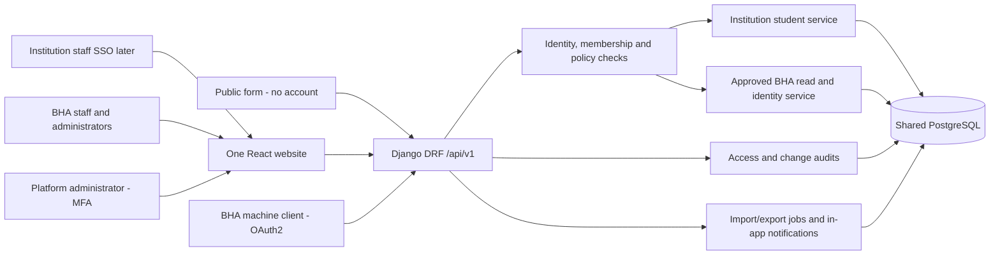
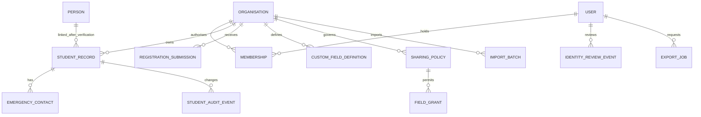

# Horseracing Student Record Management System
## Consolidated Product Master Plan and Codex Reference — Decisions Through Section O

**Document ID:** HSRMS-MASTER-001  
**Version:** 2.1 (Task 002 completion roadmap)\
**Originally prepared:** 18 November 2026  
**Updated:** 28 November 2026\
**Owner:** Independent software developer / prospective SaaS provider  
**Status:** USER-CONFIRMED DESIGN BASELINE; TASK 002 IN PROGRESS; TASK 003 ON HOLD; stakeholder and legal approvals pending\
**Delivery context:** Original one-month fictional-data prototype aspiration. Current Task 002 evidence and sequencing are tracked in §24.3.\
**Expected users:** BRS, SRA, NHC, The National Stud, and authorised BHA consumers (all prospective, not customers under contract)

> **AUTHORITATIVE RULE FOR CODEX:** This document, alongside `School Admin Project Decisions.md`, is authoritative for the *owner's confirmed intentions*, not for facts or requirements unverified with institutions, the BHA, legal advisers, or technical tests. Labels below have strict meanings. Never convert a proposal or TBD into a confirmed requirement. If a conflict arises, stop on the conflicting feature, record the conflict, and ask the owner. **Do not start Task 003** or implement planning requirements until the owner explicitly authorises it. Do not implement the full project in one unsupervised pass. Follow the phase gates and test criteria.

## 0. How to read this document: evidence, scope and priority

### 0.1 Authority and status

- **[CONFIRMED BY OWNER]** The owner explicitly chose this product outcome, including subsequent Sections A–O and final follow-ups. This is **not** legal/stakeholder approval.
- **[REPORTED IMPLEMENTED]** A historical implementation report. Use repository, test and GitHub evidence to determine current status.
- **[ENGINEERING RECOMMENDATION]** Proposed technical implementation for an approved outcome; Codex may choose an equally safe, tested approach after inspecting the code.
- **[STAKEHOLDER / LEGAL REQUIRED]** Requires actual institution/BHA approval, contract, data-protection review, or vendor verification before real data.
- **[DEFERRED]** Intended later capability; inclusion in this plan is not permission to code it now.
- **[OUT OF SCOPE]** Not part of the planned system.
- **TBD** An open implementation or external decision; document safe interim behaviour, do not guess.

**Milestones:** `P0-DEMO` = synthetic-data prototype; `P1-EVALUATION` = capabilities to trial with institutions using permitted data; `P2-PRODUCTION` = contractual/privacy/security requirements before any live personal data. The original one-month goal was a prototype ambition, not a production deadline.

**Authority order:** The latest explicit owner decision governs the affected issue; then the earlier six discovery sections; then engineering proposals. The updated discovery register records chronology. Institutional contracts/law may restrict live deployment even when the product behaviour is confirmed.

### 0.2 Current execution state

| Item | Known status |
|---|---|
| Task 001 | Foundation present in baseline `57408d1`: Django/DRF tenant-scoped read API, base models, synthetic seed, React/Vite scaffold, Docker/CI configuration |
| Task 002 | **In progress.** See §24.3 for current implementation, verification and GitHub evidence. |
| Task 003 | **NOT AUTHORISED; ON HOLD.** This document update is not a Codex implementation command |
| Environments | **One development environment** for now, using fictional data only |
| Real institutional participation | No school/BHA adoption or data-sharing agreement verified |
| Real BHA data sharing | **Disabled until formal approved sharing arrangements**; synthetic grants may demonstrate how baseline policy would work |

### 0.3 Scope and core boundaries

1. Exactly four education institutions: **British Racing School (BRS), Scottish Racing Academy (SRA), National Horseracing College (NHC), The National Stud**. **BHA is an oversight consumer, not a school.**
2. Student record management only: registration, authorised record CRUD, fields, history, status, archive, recoverable deletion, imports, BHA approved search/identity/exports. **No** courses, training statistics, attendance, qualification, placement, finance, student accounts or V1 document uploads.
3. One website and one PostgreSQL database, with independent school-owned records and strict Django permission/tenant enforcement; evaluate PostgreSQL Row-Level Security as defence in depth.
4. No student data from a real school in development/test demos. No invented BHA integration or sharing authority.
5. Institution staff handle possible duplicate students within their school; **all authorised BHA staff** handle cross-school identity verification/link/unlink.
6. Platform owner has **direct access to every institution's records at any time** as an owner-selected product rule; mandatory MFA and audit, and contractual/legal authorisation before live use. This is not permission for school users to read other schools' records.
7. See §3 for the confirmed decisions and the companion discovery register for individual Section A–O answers. In case of conflicting older statements, the latest decision register governs.

---

## 1. Executive summary, problem and outcomes

**[CONFIRMED BY OWNER]** Build an independently owned, commercially offered **multi-institution student record management SaaS**. It should (a) replace or reduce fragmented/manual records where applicable, (b) offer consistent core student data across four schools, and (c) allow the BHA to access an *institution-approved, operation-filtered authorised subset* in real time through a web portal and secured REST API. No institution or BHA participation is currently agreed.

**Proposed value hypothesis, not verified customer pain:** authorised staff can create, find, correct, import and archive student records; students submit initial forms without registering accounts; a central service can safely link verified same-person identities; BHA staff and applications can retrieve approved institution-owned information without repeated unsecured file transfers. Whether these benefits justify a subscription must be validated with potential customers.

**Commercial constraints [CONFIRMED BY USER]:** solo builder with AI/Codex assistance; initial cash budget **£0–£100** (excluding own time); initial working version within **~1 month**; launch one institution first, then expand; independently own and maintain code/business; sell institution subscriptions if interest and legal arrangements permit; synthetic data only during development; no prospective school contacted yet.

**Success gates:**
- **Prototype:** seeded four-school demo; isolation demonstrated; staff records and student submission flow; BHA filtered read-only demo; automated smoke/security tests.
- **Evaluation MVP:** realistic staff onboarding, extensible form definitions, import diagnostics, BHA portal search/consolidation/export subject to demonstrable test grants, user acceptance using synthetic data.
- **Production:** verified institutional workflow, legal/contractual basis, DPIA and child-data safeguards, real BHA field and access grants, secure deployment, assurance testing, tested backups/recovery, support and incident process. **No real-data launch before all applicable production gates are satisfied.**

## 2. Institutions, BHA and factual boundaries

**These are prospective clients, not current clients.** Do not put their logos in public marketing or imply endorsements without permission. Internal synthetic-data seed codes are permitted for prototyping; publicly deployed demos should be clearly labelled unofficial.

| Organisation | Verified public context | Design implication (recommendation, not their confirmed requirement) | Still unknown |
|---|---|---|---|
| **BRS** — British Racing School | Official BRS site describes foundation training, apprenticeships, jockey and related courses [S1]. | Flexible records across ages and different course-entry routes; no training engine in scope. | Current student admin software, data standards, IDs, approval workflows, retention and procurement. |
| **SRA** — Scottish Racing Academy | Borders College describes collaboration with Scottish racing partners [S2]. | Allow institution-specific fields and account for cross-organisation data-controller/processor questions without onboarding partner colleges as tenants. | Whether SRA or partners maintain authoritative records, approved data flows, actual legal entity. |
| **NHC** — National Horseracing College | Official college course catalogue includes foundation and racing apprenticeship education [S3]. | Same common identity/record model as BRS, configurable extra fields. | Current records, retention, IDs, system integrations. |
| **The National Stud** | Official education pages describe thoroughbred industry training including longer and short courses [S4]. | Institution-specific record fields; stud/breeding activities do not justify building training modules now. | Admin workflows, IDs, records systems and required extra fields. |
| **BHA** — British Horseracing Authority | Public recruitment/training pages describe an industry-wide recruitment and training role [S5]. | Scoped BHA API and portal *if formal access is agreed*. | Existing BHA APIs, specific data purposes, legal basis, permitted fields, search/export rights, real integration systems. |

**[OUT OF SCOPE]** Other racing colleges, partner colleges, employer portals, awarding bodies, the whole horse-racing workforce and industry training statistics. Such entities may exist as external references later but **must not become target tenants**.

### 2.1 Stakeholders and people

- **Product owner / platform operator:** manages development, operation, platform configuration; **direct access to all schools' records at any time** (OWNER-CONFIRMED; live contractual acceptance and robust security audit required).
- **Institution administrator:** full institution administrative permissions, invitations and within-policy data sharing.
- **Institution administrative staff:** create/edit/archive records, review submissions, import and change BHA sharing options within approved constraints.
- **Read-only staff:** search/read only institution-authorised records, no modification.
- **Public student applicant:** submits institution-specific form; no login account; no ability to modify an approved record directly.
- **BHA administrator:** manages BHA accounts/permissions within granted access; **cannot grant BHA new institution data categories**.
- **BHA user:** searches authorised records, reads approved consolidated profiles, exports approved data; read-only.
- **BHA machine client:** externally authenticated API principal, limited to explicit scopes/field policies.
- **Cross-institution identity reviewer:** **all authorised BHA staff** can verify, link and unlink identities; BHA retains evidence and an audit trail. Formal review criteria still require BHA/school agreement.
- **Institution privacy representative / central incident coordinator:** jointly manage data subject requests and incidents in accordance with agreed legal responsibilities (CONFIRMED operational preference; legal roles TBD).

---

## 3. Decision register — original six sections and Sections A–O

The **full** chronological owner decision record is in `School Admin Project Decisions.md`. The matrix below is a concise authoritative index, not a new set of assumptions.

### 3.1 Original sections 1–6 (confirmed baseline)

| ID | Subject | Outcome |
|---|---|---|
| D1 | Product and tenants | Four schools; one commercial record-management platform; independent records; BHA portal **and** API; no student accounts |
| D2 | Student information | Legal name, DOB, gender, nationality, contact/address, up to two emergency contacts, status, institution-specific fields; current and historical imports |
| D3 | Staff workflows | Institution admin/admin staff edit; read-only view (subject to restrictions); student form reviewed by school staff; direct staff records require no second approval; institution staff manage own-school duplicates |
| D4 | BHA | Approved search/view/export, distinct person verification and consolidated view only when verified; BHA administrators manage BHA users; schools control sharing |
| D5 | Protection | Under-18/adult support, secure remote access, MFA administrators, institution-defined retention, central incident coordination, UK-region production-hosting preference |
| D6 | Delivery | Solo developer + AI, £0–£100 initial budget, fictional-data prototype first, prospective customers only, one-school pilot then expansion |

**Later decisions override these original answers where explicitly different.** Examples: deletion now includes admin staff with a 48-hour restore window; BHA excludes archived records; platform admin now has direct record access; BHA baseline fields have been proposed by the owner but remain legally gated.

### 3.2 Additional discovery Sections A–C: student detail

| Section | Confirmed outcomes |
|---|---|
| A | School-prefixed permanent IDs: `BRS-0001`, `SRA-0001`, `NHC-0001`, `STUD-0001`; schools configure mandatory/custom fields; same-school intentional repeat records require staff review; 2 emergency contacts maximum; audit history; archive/search/restore; Active/Completed/Withdrawn |
| B | Dashboard; both table and card views; quick and full edit; advanced search; explicit Save Changes; institution admins and admin staff manage fields/archived restoration and can read edit history |
| C | Warn/reject stale edits; detect potential duplicates using name/DOB/email/phone, allow flagged save; never reuse IDs; six custom field types; new required fields only for newly created records; administrator-controlled populated-field deletion subject to retention; staff choose status when unarchiving; new platform IDs for historical imports; email/phone requiredness configurable |

**Quick edit:** email, phone, address, status. **Globally mandatory for new records:** legal name and DOB. **Duplicate review actor:** authorised **institution staff**, not the platform owner; no automatic merge.

### 3.3 Sections D–I: platform, authentication, record privacy

| Section | Confirmed outcomes |
|---|---|
| D | Staff may have memberships in several schools; one shared website and PostgreSQL DB; separate institution records; schools have field-level and record-level BHA controls; valid import rows may succeed even if others fail; no populated custom-field type mutation; access history; **one dev environment** |
| E | Institutional Microsoft/Google SSO eventually; in-app institution switcher; changes visible on refresh; manual restoration of old values via audit; temporary caching; clear errors |
| F | Invite-only staff; separate secure MFA login for platform/BHA administrators; Task 002 demo login temporarily; manual access removal now/IdP synchronisation later; 60-minute inactivity logout |
| G | Read-only staff can view full fields by default unless hidden; institution admins/admin staff can export; new record at next school instead of transferring ownership; in-app notifications; cache non-sensitive settings only; audit sensitive views and exports |
| H | Admins/admin staff can hide fields or whole records from read-only users; list 25/page max 50; individual saves with atomicity; bulk imports separate; large exports use asynchronous jobs; API rate limits by audience; `/api/v1/` |
| I | Read-only restrictions must apply to searches, counts, and exports but do not automatically change BHA sharing; choose authorised export columns; download expiry 24 hours; registration/duplicate/export/access notifications; own-school access history visible to admins/admin staff |

### 3.4 Sections J–O: resilience, privileges, BHA

| Section | Confirmed outcomes |
|---|---|
| J | Daily backups; production target 4-hour recovery; browser-memory unsaved edit preservation on interruption (no offline saves); stop edits if DB offline; cancel/revalidate revoked exports; alert owner and affected institution admins; safe rollback |
| K | 30-day encrypted backups stored separately; retention-compliant deletion; security logs cross-institution for owner; transient background job retry with idempotency; validate migrations and restore before production deployment |
| L | **Platform administrator directly accesses records across all schools, at any time**; schools manage staff; switching warns on unsaved changes; Django isolation plus RLS assessment; platform technical settings access; security login logs |
| M | Direct platform access confirmed; three-field baseline BHA sharing *only after lawful onboarding approval*; BHA admins manage BHA accounts; unverified records stay separate; schools preview effective BHA disclosures |
| N | BHA baseline **legal name, institution name, school student ID** (disableable per school); **non-archived** Active/Completed/Withdrawn only; authorised BHA API; independently visible suspected duplicates |
| O | Verified consolidated BHA profile retaining each school’s values; **all authorised BHA staff** may verify/link/unlink cross-school identities; BHA admin controls user search/export; **≥150 student rows** needs BHA admin export approval |

### 3.5 Later explicit clarifications (the latest owner answers)

- **Deletion (latest):** Institution **administrators and administrative staff**, without approval, can delete an institution student record. It becomes unavailable to normal staff/BHA immediately. **Restore the entire record, with same student ID, within 48 hours.** Afterward no ordinary interface restore; lawful retention/holds and backup erasure obligations govern physical purging. Read-only staff cannot delete/restore.
- **Within-school duplicates:** School staff who know the students investigate, approve legitimate repeat episodes, dismiss false matches or correct errors. Platform owner is not routine duplicate approver.
- **Cross-school matching:** All authorised BHA staff compare identifying information and manually verify/link/unlink, with audit and concurrency controls. No auto merge and no cross-school data exposure to institution staff.
- **Public student forms:** Secure links, no applicant accounts, staff approval before official creation.
- **Large BHA export:** **150 or more records** requires an additional BHA administrator approval.
- **Historical imports:** CSV/XLSX preview, validate each row, show duplicate warnings, import good rows even if bad rows exist; new platform IDs for all imported students.
- **Data-loss risk accepted for present backup direction:** Daily backup can leave up to ~24h of committed edits lost if catastrophe destroys live DB after last backup; not the same as four-hour recovery time.
- **Task 003 is on hold.** These decisions are plan content, not an implementation order.

### 3.6 Important distinction: chosen product policy vs live permission

BHA 'default' sharing fields are a **future approved baseline**, not an exception to lawful authorisation. An institution's onboarding and data-sharing permissions must be established before any real student details are exposed. Schools may opt out of individual baseline fields unless a legally verified obligation provides otherwise. BHA's overall effective access is the intersection of legal envelope, school grant, per-record restriction, operation (search/view/export), principal role and non-archived/non-deleted status. Restricting data from read-only school staff is a **separate** decision and does not override BHA's policy.

---

## 4. Functional requirements with acceptance criteria (current design)

These describe intended **outcomes**, not claims of implemented code. Follow milestone labels and Task 003 hold.

| ID | Requirement and authorised actor | Acceptance criteria | Milestone |
|---|---|---|---|
| ORG-01 | Four institutions; BHA oversight separately | Exactly 4 education tenants; no BHA-owned student records | P0 |
| ORG-02 | Staff can hold multiple school memberships | Membership verified on every request; switch without signing out; clear old tenant data | P1 |
| ORG-03 | Platform admin direct cross-school records | Direct record access at any time; enforced MFA and audited automatically; not dependent on school permission prompt | P1 design / P2 governance |
| IAM-01 | Institution administrators invite/change/revoke staff | Active invitation and valid school membership required; revoke immediately | P1 |
| IAM-02 | School staff SSO via Microsoft/Google | Verify provider/tenant subject ID, then check invite/membership; keep demo auth until ready | P1/P2 |
| IAM-03 | Separate secure platform/BHA admin login | Mandatory MFA; no bypass by ordinary demo login in production | P2 |
| IAM-04 | Inactivity timeout | 60 minutes idle => server invalidation; expired session cannot make changes | P1/P2 |
| STU-01 | School admins/admin staff create records | Globally legal name + DOB; school required-field policy; auto-generated local nonreused ID; audit | P0/P1 |
| STU-02 | Individual authorised staff edit and quick/full edit | Save Changes explicit; atomic; stale version rejected 409; old/new audit | P1 |
| STU-03 | Custom fields and contact data | Short/long text, number, date, dropdown, yes/no; max 2 emergency contacts; institution-only validation | P1 |
| STU-04 | Grandfather existing students | New required fields only on records created after change; older edits remain valid | P1 |
| STU-05 | School-status and archive workflows | Active/Completed/Withdrawn; separate `archived_at`; archived hidden normally/searchable/restorable with chosen status | P0/P1 |
| STU-06 | Delete/restore | Institution admin/admin staff delete without approval; record inaccessible immediately; restore **within 48h** with same original ID; lawful erasure later | P1 design / P2 deletion governance |
| STU-07 | School record visibility | Read-only staff view all by default; authorised admin staff hide selected fields/whole records; backend list/search/count/export non-disclosure | P1 |
| STU-08 | Duplicates and identity | Suspected within-school match saved and flagged; institution staff resolve; BHA staff alone verify cross-school links | P1/P2 |
| STU-09 | Search/presentation | Dashboard counts, table/cards toggle, combined search, page size 25 default max 50, authorised fields only | P1 |
| STU-10 | Audit and manual corrections | Record before/after, actor, timestamp; admin/admin staff see history, manually restore values after validation | P1/P2 |
| REG-01 | Public student forms | Institution-specific secure link; no account; pending submission; rate-limited; age-aware notice | P1/P2 |
| REG-02 | Staff approve/reject submissions | Creates one official record once; duplicate check; atomic approval; cannot auto-overwrite existing record | P1 |
| IMP-01 | CSV/XLSX import | Preview, mapping, errors, duplicate flags; each row atomic; import valid rows; new school ID | P1 |
| EXP-01 | School CSV/XLSX export | Institution admin/admin staff choose permitted columns; private asynchronous large jobs; 24h expiry; recheck permission | P1/P2 |
| ID-01 | Stable central person UUID and manual BHA verification | New UUID initially unverified; all authorised BHA staff may link/unlink with audit; unverified records remain independent | P0 ID / P1/P2 verification |
| SHR-01 | School controls BHA data | Formal baseline legal name+institution+local ID, selectively disableable; per-record & extra per-field grants; legal envelope required | P1/P2 |
| SHR-02 | Exclude archived and deleted from BHA | All non-archived Active/Completed/Withdrawn eligible only when otherwise granted | P1 |
| BHA-01 | Read-only BHA portal + API | Operation-specific search/view/export filters, no unsupported PII, current reads, distinct unverified records | P1/P2 |
| BHA-02 | Consolidated verified profile | Show verified attended schools' separately approved fields, no cross-school overwrite or invented match | P1/P2 |
| BHA-03 | BHA large exports | **≥150** rows requires BHA admin approval; asynchronous; filtered; 24h private link; revoke/revalidate | P1/P2 |
| AUD-01 | Sensitive views and exports | Access events visible to institution admins/admin staff for their records; secure cross-school security logs and platform access log | P1/P2 |
| NOT-01 | Notification centre | In-app only: registration, duplicate, export and important access events, plus failure notices | P1 |
| OPS-01 | Backup and recovery | Daily encrypted isolated backups retained 30 days; goal RTO ≤4h, worst-case daily RPO ~24h; tested restore | P2 |

**Atomicity distinction:** Individual record saves (including nested contacts/audit) are all-or-nothing. A multi-row import can accept valid rows while rejecting invalid ones; retries must be idempotent.

---

## 5. Non-functional requirements and targets

| ID | Requirement | Current target / commitment | Status |
|---|---|---|---|
| NFR-01 | Tenant and field confidentiality | No unauthorised cross-school reads/writes; school view/export/search/count restrictions; BHA grant filtering | Confirmed outcome; negative tests mandatory |
| NFR-02 | API versioning | `/api/v1/`, bounded pagination and stable error contract | Confirmed |
| NFR-03 | School list pagination | 25 rows by default, max 50 | Confirmed |
| NFR-04 | Student freshness | Fetch student records fresh; visible after refresh/reopen; cache non-sensitive settings only | Confirmed |
| NFR-05 | Availability | High availability wanted; numerical SLA **not agreed** | Stakeholder TBD |
| NFR-06 | Recovery time | **4 hours** after serious failure | Owner target; must be demonstrated before guarantee |
| NFR-07 | Recovery point | **Daily backups; worst-case ~24 hours of changes can be lost** | Owner accepted risk; not a guarantee |
| NFR-08 | Backup retention/storage | **30 days**, encrypted, separate from live DB | Confirmed future production requirement |
| NFR-09 | Export lifecycle | In-app job status, private downloads, **24-hour** expiry, permission revalidation | Confirmed |
| NFR-10 | Security sessions | 1-hour inactivity timeout; MFA for admins; immediate offboarding | Confirmed design, implementation TBD |
| NFR-11 | Performance | Efficient indexed reads, no unbounded list/export; measured latency SLO later | Engineering recommendation |
| NFR-12 | Accessibility | Aim for WCAG 2.2 AA, particularly public forms for minors | Engineering recommendation; audit needed |
| NFR-13 | UK GDPR and child-data safeguards | Lawful basis, purpose limit, minimal disclosure, institution-specific retention, DPIA assessment | Real-data gate, legally validated |
| NFR-14 | Deployment | One development environment now; production isolation before real data; UK-region managed hosting preferred | Owner confirmed + future requirement |
| NFR-15 | Secret/cookie protection | HTTPS, CSRF-safe server sessions, nonpublic credentials, encryption, minimal logs | Security recommendation |
| NFR-16 | Safe rollout | Backward-compatible migrations, tests, idempotent jobs and reversible app deployment | Owner approved principles |

**Two windows are different:** 48h recoverable user deletion; 24h possible recovery-point data loss after catastrophic DB destruction. Neither equals 30-day encrypted backup retention.

---

## 6. Technology and high-level architecture

**Current existing technical direction:** One monorepo, one React/TypeScript/Vite frontend, one Django REST Framework backend, one PostgreSQL database, modular monolith, institution-aware permission services. **Do not replace Task 001/002 code without first auditing it.** No microservices, Kubernetes, Kafka, Elasticsearch or analytic warehouse required.



- **Institution SSO:** Microsoft/Google organisational OIDC where actually supported; validate provider subject, tenant and audience, then check explicit invitation/membership. **Do not** authorise membership by email suffix alone. Keep working demo password login in the single fictional-data development environment until SSO is developed and tested.
- **Administrator login:** Separate secure platform/BHA administrator pathway, MFA required. Other BHA staff authentication details and organisational SSO need BHA confirmation; do not invent provider settings.
- **Sessions:** Server-side session cookies with Secure/HttpOnly/SameSite and CSRF enforcement; one-hour inactivity expiry; membership revocation invalidates access promptly; school switching clears old school state and warns before discarding edits.
- **Read access:** Every school query tenant-scoped; policy filters applied before search/count/pagination; platform administrator has explicit super-admin path for direct all-school record access, subject to MFA and tamper-resistant audit. Evaluate DB RLS as secondary safeguard without disrupting owner-authorised platform access.
- **Caching:** Cache non-sensitive institutional settings only, keyed and invalidated per tenant. No broad browser/server cache of student records; read latest committed record. Brief unsaved edit values may remain in **memory only**, not durable browser storage.
- **Background jobs:** Initially a simple reliable database-backed job queue is acceptable for exports/imports/notifications; use durable job state, retry logic, lease/lock and idempotency. Celery/Redis not a mandatory starting dependency.
- **Machine-to-machine BHA access:** Standards-based OAuth2 client credentials and scoped API, not hard-coded bearer strings; exact integration TBD with BHA.
- **Testing/quality:** pytest/pytest-django, Ruff, migrations, CI, frontend Vitest/TypeScript and Playwright where supported, PostgreSQL-backed integration test where feasible. Verify actual tools from repo instead of assuming they work.
- **Optional UI libraries:** Tailwind/shadcn, TanStack Query/Table, React Hook Form/Zod where present; do not add or remove them without inspection.

### 6.1 Suggested repo module boundaries (subject to existing code)

`accounts/`, `organisations/`, `identity/`, `students/`, `registrations/`, `sharing/`, `bha/`, `imports/`, `exports/`, `audit/`, `notifications/`, `core/`. Central permission checks and transactional service functions enforce invariants; views/serializers are not independent security authorities. Add modules only if needed, not for decorative architecture.

---

## 7. Relational data model and invariants (proposed, inspect current migrations first)

This is a **target design**, not confirmation that these columns/tables exist. Preserve completed Task 001/002 migrations and records; implement safe deltas only when separately authorised.

### 7.1 Core relationship



**Rules:** `Organisation` holds four institutions and one separately typed BHA oversight organisation, never BHA-owned student records. `User` + `Membership` scopes school membership. `Person` is a central opaque identity reference. `StudentRecord` is school-owned and stores school-specific copies of student data. A person may have records at multiple schools; linking does not transfer/merge owned values. Matching automatically produces **candidates**, not verified links. Verified linking/unlinking is by authorised BHA staff, audited with evidence and concurrency protection.

### 7.2 Proposed table/field guidance

| Table / concept | Fields, constraints and invariant |
|---|---|
| `organisations` | UUID PK, fixed demo codes `BRS`, `SRA`, `NHC`, `STUD`, `BHA`; name, type (`institution`/`oversight`), timestamps |
| `users` | UUID PK, normalised unique email, MFA/admin flags, active; external identity provider + issuer/tenant/subject bindings eventually, not email-domain-only linking |
| `memberships` | User + organisation + role, active/revoked timestamps; unique active membership policy, school switch context checked on **every** API request |
| `persons` | Stable unique UUID, verification status (unverified/verified), provenance; never infer verification from issuance |
| `student_records` | UUID PK, institution, person reference, unique `(organisation, student_number)`, legal first/last name, DOB, gender, nationality, email, phone, address, status, custom values, `joined_institution_on`, `created_at`, `updated_at`, version |
| IDs/sequences | School-specific atomic counters; initial formats `BRS-0001`, `SRA-0001`, `NHC-0001`, `STUD-0001`. Forever reserve issued numbers, including failures/purges where possible; no `MAX+1` race; imported records also get new IDs |
| Lifecycle | `status = active/completed/withdrawn`; `archived_at` separate; `deleted_at` separate and usually `recover_until = deleted_at + 48h`; `deleted_by`, immutable audit, retention hold/purge eligibility; BHA rejects both archived and deleted |
| `emergency_contacts` | Student FK, name, relationship, phone/email as configured, primary flag; **0–2 contacts** per student, max one primary if applicable, backend enforced under concurrency |
| `custom_field_definitions` | Tenant, stable key, label, type (`short_text`, `long_text`, `number`, `date`, `dropdown`, `boolean`), requiredness, choices, active version; no direct type change when populated |
| Field settings | Institution-level mandatory rules plus version/created-before cutover to preserve previous records; system-minimum legal name and DOB cannot be disabled for new record creation |
| `registration_submissions` | Institution, validated pending form snapshot, status pending/approved/rejected/correction_requested, approver/time; student account not created; approve once in transaction |
| `student_audit_events` | Actor, school, record, action, field old/new values (protected), time, request/version; manual restoration creates another audited edit rather than rewriting history |
| `access_events` | Sensitive view, search where justified, exports, platform cross-school reads, BHA read/identity access; restrict access and retention; no raw credentials |
| `duplicate_reviews` | Own-school record candidate matches, evidence/decision/actor/time; institution admin/admin staff resolution; saved records may be flagged pending review |
| `identity_reviews` | BHA staff identity verification, link/unlink decision, evidence reference, actor/time, stale-version prevention; no destructive merge |
| `sharing_policies` | School-level active/grant versions, baseline legal name+institution+school ID where formally approved, additional approved allowlist, per-record restrictions, search/view/export operation |
| `import_batches` | School, file metadata, preview/row errors/duplicate flags, state, row idempotency key; valid-row partial success; every created record gets new platform ID |
| `export_jobs` | Requester, tenant/BHA scope, selected authorised columns, filters, calculated row count, BHA admin approval if ≥150 rows, state, expiry+24h, access/download audits |
| `notifications` | Recipient, tenant context, type, linked object scoped safely, read timestamp; no email notification required in initial agreed design |
| `retention_policies` / `deletion_jobs` | Institution-specific lawful retention, legal holds, 48-hour grace window, later purge/evidence and backup expiration handling; details await live approval |

**Important distinction:** `joined_institution_on` records the student's entry date (nullable for unknown historical data as appropriate); `created_at` means the date the software record was created. Do not fabricate joining dates for imports.

### 7.3 Record save and history rules

1. A student record always belongs to exactly one institution; no general update may change `organisation_id`.
2. Institution staff can see only their authorised school's records, not the content/existence of another school's records. Switching memberships does not circumvent permission checks.
3. The platform admin has an **explicit super-administrator permission path** to open all school records directly, independent of school grants. It must be strongly authenticated and automatically audited.
4. Student IDs are auto-generated, unique per institution, stable and **never recycled** after archive, delete or import. Do not rewrite Task 002 IDs by migration.
5. Save each student change together with nested contact/custom values and its audit event in one transaction. Reject stale version edits (HTTP 409).
6. Archived records remain stored, searchable/restorable by school admins/admin staff; staff choose new lifecycle status on restoration.
7. Deleted student records are hidden immediately from normal school/BHA access, including search and exports. School admins/admin staff may restore within **48h** with same ID and contents. Once window expires, deny normal restore; lawful retention/hold and backup rules determine permanent erasure timing.
8. New compulsory fields apply only to **new records** from the setting change, not to pre-existing students when edited.
9. Potential within-school duplicate checks use name/DOB/email/phone, allow flagged saving; institution staff resolve intentional same-person repeat versus false match, never automatic merge.
10. Identity linking across schools may be performed by **all authorised BHA staff** after manual verification. Preserve separate school record values and audit link/unlink.
11. No populated custom field may be directly retyped or silently discarded; administrator-controlled data-bearing deletion must respect retention and audit requirements.
12. No user may bypass read restrictions by API filters, counts, child FKs, notifications, search or an export.

### 7.4 Data correctness / performance

Add indexes after measuring needs: `(organisation_id, status, archived_at, deleted_at)`, `(organisation_id, student_number)` unique, tenant+name search, `person_id`, per-school audit timestamps. Use `select_related`/`prefetch_related`; lists default 25, max 50. Never treat names, DOB, phone or email as a globally unique student key. For UK GDPR and minors, avoid centralising extra PII without a purpose; store only what is required for each school.

---

## 8. Permissions, role matrix and security boundaries

`Y` = allowed within stated scope; `N` = denied; `G` = only if a separately approved grant applies; `TBD` = precise scope needs policy definition. **Backend permissions, not frontend hiding, enforce all rows.**

| Operation | Platform admin | School admin | School admin staff | School read-only | BHA admin | BHA staff/API |
|---|---|---|---|---|---|---|
| Open school student record | **Y all schools, direct; MFA+audit** | Y own school | Y own school | Y unless hidden | G only | G only |
| Create/edit school student | Owner requests full platform access; exact mutation policy **TBD** | Y | Y | N | N | N |
| Review school public submissions | Operating support rights TBD | Y | Y | N | N | N |
| School duplicate decision | Not routine reviewer | Y | Y | N | N | N |
| Archive/unarchive school student | Admin mutation scope TBD | Y | Y | N | N | N |
| Delete/restore school record (48h) | Admin mutation scope TBD | **Y no approval** | **Y no approval** | N | N | N |
| View student edit/access audit | Y, protected | Y own school | Y own school | N for full audit | G BHA access only | G own authorised actions |
| Hide field/record from school read-only staff | Technical admin rules TBD | Y | Y | N | N | N |
| Change school mandatory/custom fields | Technical admin rules TBD | Y | Y (except populated destructive field deletion) | N | N | N |
| Delete populated custom-field definition/data | Governance/technical support only | Restricted and retention compliant | N | N | N | N |
| Invite/revoke school staff | Platform technical access TBD; daily responsibility school | Y | N | N | N | N |
| Configure school BHA sharing | Superadmin technical setting access; legal envelope controls | Y | Y | N | N | N |
| School CSV/XLSX export | Operational support scope TBD | Y | Y | N | N | N |
| Verify/link/unlink cross-school identities | No routine identity-review role | N | N | N | **Y** | **Y for all authorised BHA staff** |
| Manage BHA staff/search/export permissions | Bootstrap/system administration TBD | N | N | N | Y | N |
| BHA authorised search/view | Within contractual support rights TBD | N | N | N | G | G |
| BHA export of ≥150 records | No bypass assumed | N | N | N | **Approve** | Request; needs BHA admin approval |

**Read-only staff:** By default can view the full authorised school record, including address and emergency contacts. Institution admin/admin staff can hide **individual fields** or **entire records** from read-only users; do not show hidden-record existence in lists, searches, counts, IDs, exports or notifications. This internal visibility policy is independent from BHA grants.

**Operator access:** The owner explicitly rejected break-glass-only, purpose-prompt-gated access. Direct full-school record access must not be quietly changed into an approval workflow. However, strong operator MFA, least-privilege service credentials, immutable/tamper-evident access logging and a contractually lawful role are essential before real data. Exact platform-admin record **write/destructive** permission boundaries remain a separate decision and must not be invented.

### 8.1 Data-scoping enforcement

- Validate current active membership on every school API call, including nested objects, field definitions, imports, status actions, audit reads, dashboard counts and export downloads.
- Apply record/field visibility before filtering/pagination/aggregation, not after; returning `403` versus `404` must not reveal another school's student existence.
- School staff must never receive cross-school identity candidate values. Only a BHA-authorised identity workflow can compare/link identities across institutions.
- BHA effective access = lawful onboarded envelope ∩ institution active grants ∩ per-student restrictions ∩ operation-specific search/view/export permissions ∩ principal permissions ∩ **not archived and not deleted**.
- BHA sharing changes take effect on the next request; pending exports and download links must be rechecked and blocked/cancelled if no longer authorised. Prior downloaded copies cannot be technically recalled.
- RLS may be evaluated as defence in depth. It must be engineered so the platform-admin exception is explicit and audited, not a blanket database bypass that silently conceals reads from logs.
- Extensive negative tests for unguessable IDs, nested FKs, count leaks, filters, exports and cross-school switching. School tenant isolation cannot be bypassed by the platform operator's unrestricted access existing as a separate role.

---

## 9. Core application workflows

### 9.1 Student public application

1. Applicant opens school-specific secure public link; no student account.
2. Form includes legal name/DOB minimum, configured school fields, necessary contact/emergency information, privacy explanation for adult/minor applicants and bot/rate-limit protections.
3. Submission creates a pending **registration**, not an approved student record; duplicate registration flagged for staff.
4. Authorised institution staff review, approve/reject/request correction as designed. Approval creates exactly one official record + unverified person UUID + permanent local ID + audit event **atomically**.
5. No auto-merge or overwrite of an existing student, and no student access to approved records.

### 9.2 Direct staff create and within-school duplicates

Institution admin/admin staff creates official record without second approval. Validate configurable fields and at most two emergency contacts. Compare name/DOB/email/phone against own-school records; if candidate duplicate, **allow save but flag**. Institution staff can dismiss false positive, correct underlying data, or approve a legitimate additional record/episode. The platform owner is **not** responsible for school duplicate approval. School staff must not see other schools' candidate details.

### 9.3 Edit, concurrent updates and manual recovery of values

Full and quick-edit interfaces require Save Changes. Quick edit: email, phone, address and lifecycle status; full editor handles all authorised fields and contacts. Use optimistic version/ETag; return 409 for stale edits and ask staff to refresh. Commit record+contacts+audit together. Full prior values are visible to institution admin/admin staff; manual restoration is a **new audited edit** through current validation, not one-click whole-record rewind. If a connection drops, hold unsaved data in **browser memory only** and revalidate on retry. Never queue offline writes while DB is unavailable.

### 9.4 Status, archival and deletion

- `active`, `completed`, `withdrawn` are lifecycle statuses; archive is a separate flag.
- Archive removes from default list; authorised staff can search and restore. Staff choose a lifecycle status during unarchiving.
- **Delete:** institution admin/admin staff without approval; mark deleted and hide immediately from school normal views, BHA and export. Allow **48-hour** restoration to full record and original ID. After window, lock ordinary restore and process permanent erasure according to school retention/legal holds, audit and backup obligations. Ordinary deletion does not automatically erase all copies at 48 hours; retain necessary evidence responsibly.
- A deleted/archived ID is never reused.

### 9.5 Cross-school identity verification (BHA only)

Possible matches from identifying details create candidates, not automatic links. **Any authorised BHA staff member** may compare permitted evidence, verify, link or unlink school records, document decision, and preserve event history. Concurrency control prevents one review silently overriding another. An incorrect link can be undone without deleting institutional records. Schools retain independent and potentially conflicting field values. Unverified similar students remain separate in BHA results if individually authorised. Final evidence standards and dispute/escalation policies must be agreed with BHA and schools.

### 9.6 CSV/XLSX historical import

Upload → validate file/size/type → map columns → preview individual errors and likely duplicates → confirm → process valid rows with atomic student creation and new school-specific ID → report invalid rows for correction. Partial valid-row success is permitted; retries are idempotent; no cross-school writes. Preserve original external school identifier as controlled import metadata where needed, not the new platform student ID. Historical cutoff/source formats are institution TBD.

### 9.7 Exports and in-app notifications

School admins/admin staff export own authorised school data, selecting fields within permissions. Large exports run as jobs; notify inside website when ready. BHA jobs compute allowed row counts and require **BHA admin approval for 150 or more records**. Every execution/download rechecks grants, archive/delete/record exclusions and selected columns. File links last 24 hours and are private; expired artifacts are removed. In-app notification centre covers registrations, duplicate reviews, completed/failed jobs and important access changes; no routine workflow notification emails requested.

---

## 10. BHA service, permission and API contract

### 10.1 Formal data access gates

Before live data, the four institutions and BHA must confirm purpose, lawful basis, controllers/processors, agreed baseline fields, retention, identity verification and per-operation (search/view/export) permissions. Until then **no real student information is exposed to BHA**. Synthetic test grants can illustrate the design only.

**Owner-selected baseline, effective only after approval:** `legal_name`, `institution_name`, `institution_student_id`. Institutions may disable default fields unless a separately verified legal obligation compels disclosure. DOB, email, phone, home address, gender, emergency contact and other data require additional explicit grants.

Schools may restrict BHA access per record independently of internal school read-only restrictions. School admins **and admin staff** manage approved school grants; cannot expand beyond formally approved envelope. In BHA portal, institutions can preview/test **effective** data visibility before saving. In BHA API/exports, enforce the same policy server-side.

**BHA status visibility:** Only **non-archived, non-deleted** Active, Completed or Withdrawn records are eligible. This supersedes older proposals allowing BHA historical archived records. Suspected duplicates can appear as distinct approved records, never as verified linked identities until reviewed by BHA staff.

**Verification:** All authorised BHA staff may link/unlink cross-school identities with evidence and full audit. School values remain separate in consolidated profile. BHA admin manages user search/export roles; all authorised BHA staff still hold the confirmed identity-review capability.

### 10.2 Proposed API endpoints (not existing verified implementation)

All routes under **`/api/v1/`**; owner has confirmed versioning but not these exact resource names.

| Method | Illustrative path | Actor and meaning |
|---|---|---|
| GET/POST | `/students/` | School staff: tenant-scoped paginated list (25/50), individual create |
| GET/PATCH | `/students/{id}/` | School staff: field-filtered view and version-checked update |
| POST | `/students/{id}/archive/` | School admin/admin staff: archive |
| POST | `/students/{id}/restore-archive/` | School admin/admin staff: choose lifecycle status |
| POST | `/students/{id}/delete/` | School admin/admin staff: start 48-hour recoverable deletion |
| POST | `/students/{id}/restore-deleted/` | School admin/admin staff: restore within 48 hours |
| GET | `/students/{id}/history/` | School admin/admin staff: change and relevant access history |
| GET/POST | `/student-field-settings/` | School admin/admin staff: configured fields and requiredness |
| GET/POST | `/student-duplicate-reviews/` | School admin/admin staff: flagged matches and decisions |
| POST | `/public/institutions/{code}/registrations/` | Anonymous: secure pending application |
| POST | `/registrations/{id}/approve/` | School admin/admin staff: transactional approval |
| POST | `/imports/` | School admin/admin staff: CSV/XLSX preview and validated import |
| POST/GET | `/exports/` | School admin/admin staff: job request/status; download permission checked |
| GET | `/bha/students/` | BHA user/client: approved, non-archived/non-deleted paginated search |
| GET | `/bha/students/{person_id}/` | BHA user/client: permitted verified consolidated profile |
| POST | `/bha/identity-reviews/` | All authorised BHA staff: verify/link/unlink with evidence and version checks |
| POST/GET | `/bha/exports/` | BHA: export request/status, approval for ≥150 rows |
| POST | `/bha/exports/{id}/approve/` | BHA admin: approve large authorised export |
| GET | `/bha/exports/{id}/download/` | Authorised BHA actor: fresh grant checks, 24h validity |
| GET/PATCH | `/sharing/policies/current/` | Authorised school admin/admin staff: legal envelope-bound grants |
| GET | `/sharing/preview/` | Authorised school staff: effective BHA visibility test |

Query filters can include name, central verified person reference, school number, DOB, institution, status, email, phone **only when that search operation is separately granted**. No arbitrary query language or blanket `fields=all`. BHA user clients must not receive unapproved data merely because a field is permitted as search input. Use short-lived OAuth2 credentials and scope-limited service users for API clients.

### 10.3 Error and response semantics

- `200/201` success and creation; `202` accepted asynchronous export.
- `400/422` validation (whichever is existing stable API contract); `401` unauthenticated; `403` permission denied without disclosing other-school data; `404` missing/hidden resources consistently.
- `409` stale edit, conflicting identity link or double-submission approval.
- `413` file too large; `429` request limit; `5xx` safe message with correlation ID, without stack trace or raw student details.
- Recheck school permission and BHA field grants at **search, job processing, and final download**. Revocation cancels/block jobs already pending. No copying of the entire student serializer into BHA output.
- Read latest committed records (no overnight replication). BHA data can appear after ordinary refresh/reopen; no real-time screen push required.
- For large BHA export, row-count threshold is **150 inclusive**, counting *eligible exported student records*, not unfiltered records. Approval by BHA administrator; exact self-approval workflow remains a policy detail to confirm.

### 10.4 Synthetic illustration only

A fictional authorised BHA result may have only the following fields after the fictitious school's approved grants: `legal_name: Alex Example`, `institution_name: British Racing School`, `institution_student_id: BRS-0001`. A verified consolidated result may contain separate child entries for BRS and NHC, with each school's independently authorised data. This is **not** an approval to share real records, nor proof that BHA has a particular production schema.

---

## 11. Frontend routes, usability and state

**One React website**, with public, school, BHA and platform routes. Same shared components and protected backend; UI hiding is not permission enforcement.

| Proposed route | Audience | Behaviour |
|---|---|---|
| `/login`, `/admin/login` | School staff / platform-BHA admins | Demo login temporarily; future institution Microsoft/Google SSO; separate MFA admin flow |
| `/register/:schoolCode` | Public applicant | Secure student registration without account; pending school review |
| `/app/dashboard` | Institution staff | Own-school Active/Completed/Withdrawn counts and links; do not reveal hidden records to restricted readers |
| `/app/students` | Institution staff | Advanced search, table/card toggle, page 25 default/max 50, restricted/archived filters by permission |
| `/app/students/new` | School admin/admin staff | New record, configurable fields and up to two contacts |
| `/app/students/:id` | School staff | Authorised profile, quick edit and full edit with explicit Save Changes, audit where permitted |
| `/app/students/:id/history` | School admin/admin staff | Changes, sensitive access records and manual historical-value restoration |
| `/app/registrations` | School staff | Pending student submissions; institution review and approval |
| `/app/imports`, `/app/exports` | School admin/admin staff | CSV/XLSX validation, jobs, downloads and error reports |
| `/app/settings/fields` | School admin/admin staff | Requiredness/custom fields; populated destructive deletion admin-restricted |
| `/app/settings/sharing` | School admin/admin staff | Approved BHA fields, per-student visibility grants, effective permission preview |
| `/app/staff` | Institution admin | Invite, role and access management |
| `/app/notifications` | Staff | Registration, duplicate, export and access notifications |
| `/bha/students`, `/bha/students/:id` | BHA users | Scope-filtered search, verified consolidated profiles with distinct school details |
| `/bha/identities`, `/bha/exports` | BHA users | All authorised staff may verify/link/unlink; export approval by BHA admin for ≥150 rows |
| `/bha/users` | BHA administrator | BHA staff, access permissions and revocation |
| `/platform/organisations`, `/platform/students` | Platform administrator | Global technical settings, direct cross-school record access with strong audit |

**Important UI behaviour:** Warn and preserve unsaved input in memory on brief network problems; do not auto-save. On school switch warn of unsaved edits and clear any old-school UI/query context. On logout or session expiry discard unsubmitted sensitive values from browser memory. Only cache non-sensitive school settings; get student records fresh. Respect field/record hiding before rendering list/cards/counts. Read-only staff see full student information by default unless admin/admin staff restricted particular fields/records.

---

## 12. Backend service contracts and dependencies

These are **pseudocode-level architectural responsibilities**, not ready-to-run source, and not a demand to replace Task 002 code.

```python
# PSEUDOCODE — preserve existing module/API names when appropriate
create_student(actor, institution, validated_fields) -> StudentRecord
update_student(actor, record_id, patch, expected_version) -> StudentRecord
archive_student(actor, record_id) -> StudentRecord
restore_archived(actor, record_id, chosen_status) -> StudentRecord
soft_delete_student(actor, record_id) -> RecoveryReceipt  # 48h
restore_deleted_student(actor, record_id) -> StudentRecord  # within 48h
review_school_duplicate(actor, review_id, decision) -> DuplicateReview
submit_registration(institution, validated_payload) -> PendingRegistration
approve_registration(actor, submission_id) -> StudentRecord
import_valid_rows(actor, batch_id) -> ImportSummary
school_student_query(actor, institution, filters) -> ScopedQuerySet
bha_student_query(bha_principal, filters) -> ApprovedQuerySet
bha_verify_link_unlink(actor, identity_case, action, expected_version) -> AuditEvent
request_export(actor, source, filters, fields) -> ExportJob
approve_large_bha_export(bha_admin, export_id) -> ExportJob
get_export_download(actor, export_id) -> PrivateAuthorisedFile
```

**Dependencies:** `accounts+organisations` → tenant policy → student records+contacts → audit+concurrency → submissions/imports → BHA grant service+identity verification → exports/notifications. Security checks must be reusable across DRF views, background jobs, search, counts and downloads. All sensitive access to school students, including platform-wide admin read, gets audit coverage. All per-student changes write audit in the same DB transaction; a failed request must not leave a successful-change event.

---

## 13. Validation and data dictionary

**Owner-confirmed universally required new-record fields:** legal name (first and last as model represents them) and date of birth. The other categories — gender, nationality, email, phone, home address and up to two emergency contacts — remain available and may be made mandatory **per school** within approved legal constraints. Individual school field choices cannot be invented before school engagement. Institution admins and admin staff configure mandatory/custom fields; newly mandatory fields apply to **new records only**. Store field-configuration version or equivalent rule snapshot to avoid breaking historical edits.

**Custom types:** short text, long text, number, date, dropdown selection and boolean. Validate from school-owned field definitions on backend. Do not allow direct changes to a populated field's type; administrator-controlled deletion of populated fields requires retention and audit safeguards.

**Data quality:** Unicode names, plausible DOB, email/phone format with international users, no global uniqueness assumption for email/DOB, conservative field length limits, allow valid blank values when optional, no untrusted HTML/SQL execution. Do not infer that matching name+DOB proves identity. Record student's institution **joining date separately** from software `created_at`; do not fabricate missing historical dates.

**CSV/XLSX import and export:** protect against spreadsheet formula injection; validate mapped columns, ownership and record identity; use safe output encoding; preview row errors; preserve original imported identifiers in controlled metadata if required while issuing new platform IDs.

---

## 14. Environments, hosting, backup and release operations

**Owner-confirmed current environment:** **one local/development environment using only fictional records**, containing demo membership for all four institutions and BHA. Do not require or set up an additional staging/prod environment merely because this plan discusses eventual operations. Existing local Django/PostgreSQL/React Docker setup and CI should be inspected rather than rebuilt.

**Before any real data:** Separate protected production environment, appropriately restricted secret/DB access, HTTPS, UK-region managed hosting preferably, signed institutional/BHA contracts, correct data controller/processor and sharing arrangements, production MFA, vulnerability assessment, monitored incident handling and tested backup/restore. Final hosting vendor and price **unknown**; £0–£100 is the initial prototype allowance, not a sustainable HA production budget.

### 14.1 Production resilience targets (owner-confirmed, not yet measured)

- **Backups:** Once per day, encrypted, off the primary DB/failure domain, retention **30 days**.
- **Recovery-time objective:** Aim to restore service within **4 hours** of a major failure. This is **not** a promise until demonstrated by exercises and suitable vendor capacity.
- **Recovery-point exposure:** If only last daily backup survives a catastrophic DB loss, up to **~24 hours of changes** may be missing. Owner accepted this as the present policy, subject to customer risk approval later.
- **Deletion grace:** Separate **48-hour student deletion restoration window**; does not lengthen the backup RPO and does not mean immediate erasure from encrypted backups after 48 hours.
- **Faults:** Site should block writes while database down; browser can keep unsaved form input in memory, revalidate before retry; no offline update queue.
- **Outage notifications:** Notify platform operator promptly; inform affected school administrators for significant failures.
- **Deployment:** Test migrations, regression suite and restoration steps before release; roll back application code without deleting accepted database changes; use backward-compatible changes/recovery plan when needed.
- **Jobs:** Asynchronous large exports and imports must be idempotent, cancellable/revalidated on revoked sharing policy, retry transient errors and notify in-app on outcome; private download links expire after 24 hours.

**Availability:** User wants minimal downtime but has not agreed to a numerical SLA or hosting vendor; previous 99.9% figures were illustrative only, **not a confirmed promise**.

---

## 15. Security design and specific abuse cases

Security boundaries: anonymous public form; authenticated school staff (tenant-scoped); **all authorised BHA staff** acting as central identity reviewers; BHA browser/clients with field-scoped access; **direct cross-school platform administrator access** protected by mandatory MFA and access logs; infrastructure secrets. No trust based on frontend route or hidden UI control.

| Threat | Required defence/test |
|---|---|
| User guesses another school's UUID | Tenant-filtered detail returns non-disclosing denial; negative test on every endpoint |
| BHA tries unapproved `fields=all` | Explicit allowlist intersection, no serializer expansion, security test |
| BHA searches restricted email/phone | Search grant required even without displaying field; no existence leakage |
| Attacker submits many public forms | Rate-limit, verification/anti-bot as proportionate, validation, operational alert, no enumeration |
| Admin creates record at wrong school | Server membership/active tenant validation, immutable `organisation_id` |
| Identity match false positive | No automatic merge, human review, reversible linking and audit |
| Forged update changes person ID or status | Server-owned fields excluded from PATCH; specific status and identity actions |
| CSV formula injection on export | Escape leading spreadsheet control characters, validated spreadsheet generation |
| Uploaded CSV resource exhaustion | Size/row limit, content checks, staged processing, rate limits |
| Privileged user overwrites audit trail | Append-only app role, restrict UPDATE/DELETE, log export/monitoring, tamper evidence for live |
| Leaked OAuth secret or session | Short-lived tokens, credential rotation, session revocation, MFA privileged users |
| Staff obtains another school's cached browser data | Cache by organisation and principal, clear on switch/logout |
| Deleted student remains in exports/backups | Policy-governed erasure + backup retention/restore handling |

Follow OWASP guidance for broken object-level, property-level and function-level authorisation [S9]. Use dependency/security scanning and independent penetration testing before live real-person records.

---

## 16. UK GDPR, under-18 applicants and governance gates

**Not legal advice.** Formal counsel/DPO/institution privacy input is required prior to production. ICO guidance emphasises privacy by design, minimisation, risk assessment and additional safeguards for children [S6–S8]. Where children’s personal information is shared, document compelling purpose and assess impact; the precise applicable duties depend on the online service and processing [S6, S7].

### 16.1 Decisions that must not be assumed

- Controller/processor/joint controller roles for each school, BHA and SaaS owner.
- Lawful basis for student record creation, identity linkage and each BHA disclosure; do **not** presume consent is always required or always sufficient.
- Specific fields the BHA may search, view and export; purposes and recipients.
- Whether consolidated school-attendance history can be disclosed, and for which students.
- Child-specific privacy notices; parent/guardian steps only where legally and operationally justified, not universally assumed.
- Retention duration for active, withdrawn, completed, archived, rejected, imported and emergency-contact records; legal holds and backups.
- Whether any extra fields amount to special-category data; avoid collecting medical/safeguarding information in MVP.
- Cross-border subprocessors, even if hosting region is UK; contractual safeguards and data residency checks.
- DPA, data-sharing agreements, DPIA screening/full DPIA as applicable, records of processing, security evidence and incident reporting arrangements.

### 16.2 Responsibilities (proposed operating model)

Institution manages accuracy, school staff access, sharing parameters and retention policy within law; BHA manages its user accounts and downstream use subject to authorisation; platform operator provides security, backups and support; central team coordinates access/erasure requests and incidents with institutional representatives. Actual legal responsibilities follow documented controller/processor arrangements and cannot be set by a developer chart.

**Incident plan:** detect/contain, log time of awareness, affected fields/students/tenants, notify designated institution/BHA contacts rapidly, assess likely risk, cooperate on any required ICO/data subject notification (where the applicable law requires notification within prescribed windows, often 72 hours of awareness for reportable breaches), preserve evidence, remediate, review. Do not assume central team can unilaterally decide legal notification for every organisation.

### 16.3 Privacy gates before any real data

- [ ] Signed institutional pilot/supplier arrangements and data-processing clauses.
- [ ] Confirmed BHA purposes, legal basis, grants, field dictionary and historical scope, or disable BHA PII completely.
- [ ] Recorded roles, privacy notices and DPIA outcome, with minors addressed.
- [ ] Tested mandatory admin MFA and other auth controls.
- [ ] End-to-end tenant, field and role isolation tests, independent security review.
- [ ] Managed backups, restore test, documented retention, deletion and breach response.
- [ ] Vulnerability management, logging, audit protection, operational contacts and SLA.
- [ ] Confirmed source-of-truth/migration and validation plan.

---

## 17. Delivery milestones and actual task status

**Original aspirational schedule:** Synthetic-data prototype in approximately one month from 18 November 2026, under £0–£100 initial cash budget. Build on the existing implementation and use §24.3 to identify remaining Task 002 work.

| Capability | Owner-reported / intended status | What must be verified before claiming complete |
|---|---|---|
| Task 001: base multi-tenant app | **Foundation present** in `57408d1` | Backend regression evidence is in §24.3. Project-wide CI and release verification remain at 2.10. |
| Task 002: student records and tenant security | **In progress** | Use the completion gates and evidence in §24.3 |
| Sections A–C refinements | Confirmed requirements | Check implementation differences in Task 002; some may already exist |
| Sections D–O architecture | Confirmed product-owner decisions | Distinguish repository changes needed now from future evaluation/production features |
| Task 003 | **ON HOLD — NOT AUTHORISED** | Only start after owner explicitly asks to implement and code is inspected |
| Institution SSO | Future agreed capability | Actual school IdP information, tested provider setup, migration from demo login |
| BHA identity/manual verification | Future agreed capability | Staff privileges chosen, evidence procedure/stakeholder agreement still open |
| BHA data sharing | User selected future baseline | Must have formal institutional approval and legal basis before real data |
| Production hosting, backups, deletion | Agreed operational goals | Vendor, budget, DPIA, contracts, restore tests and legal retention before real users |

### 17.1 Real-data gate

Do **not** load or process a real student's information solely because a feature exists in the demo. Live processing requires contractual authorisation, correct privacy notices/child-data protections, lawfully approved BHA fields, deletion/retention rules, MFA, documented support and security tests, and proven backup/restore. Until then all data remains synthetic.

---

## 18. Acceptance and security test matrix (future validation, not claimed passed)

Run tests using fictional records only. This matrix specifies expected behaviour. See §24.3 for actual Task 002 test evidence.

| ID | Scenario | Expected result |
|---|---|---|
| TEN-01 | BRS read-only user lists students | Sees BRS permitted records only, 25/page default 50 max |
| TEN-02 | BRS user requests SRA UUID, email search, nested contact, dashboard count or export | No existence/data disclosure |
| TEN-03 | User belonging to BRS and NHC switches within site | Authorised switch only, unsaved warning, old cached context cleared, no old-school leak |
| TEN-04 | Platform admin opens any of four schools' student records | Allowed directly with MFA/session enforcement and independently stored access audit |
| IAM-01 | Uninvited Microsoft/Google staff attempts access | Identity authentication alone does not grant membership; denied |
| IAM-02 | Institution admin disables staff membership during session | All protected routes denied on next server request; session no longer grants school access |
| IAM-03 | Platform/BHA admin lacks MFA or login idle >60min | Protected actions denied until secure reauthentication |
| STU-01 | Concurrent school-ID allocation + archival/deletion | No duplicate/reused numbers, correct school prefixes; preserve pre-existing IDs |
| STU-02 | Historical import with old external ID | New unique platform ID; external source retained safely if necessary |
| STU-03 | One student has two emergency contacts; attempt three | Two allowed, third rejected transactionally |
| STU-04 | School makes custom field required after records exist | Required for newly created only; older record can still edit unrelated field |
| STU-05 | Edit with stale version | 409 and clear refresh warning; newer changes not overwritten |
| STU-06 | Invalid nested change in student save | No fields/contact/audit changed; atomic rollback |
| STU-07 | Quick/full edits and manual restoration of historical field | Save Changes required, audit prior and new values correctly |
| STU-08 | Archive, search, restore with selected status | Archived hidden by default, restoration preserves ID and sets chosen Active/Completed/Withdrawn |
| DEL-01 | School admin/admin staff deletes student | No approval; hidden immediately; can restore with same ID/data inside 48h; audited |
| DEL-02 | Read-only user attempts deletion/restoration | Denied |
| DEL-03 | Restore request after 48h | Ordinary user restore denied; documented retention/hold deletion workflow, not invented immediate physical purge |
| PRI-01 | Read-only staff views full unhidden student | Can see fields including contacts; editing denied |
| PRI-02 | School admin/admin staff hides a field or complete record | Restricted reader cannot see it in detail, search, count, IDs, cards, API or export |
| PRI-03 | School read-only hiding policy changed | BHA independently still bound by its own grants; no unintended grant/revoke |
| DUP-01 | Candidate same-school duplicate found by name/DOB/email/phone | Save allowed with flag; institution staff review; no automatic merge |
| DUP-02 | Same person in two schools unverified | No automatic link; no other-school hints to school staff |
| ID-01 | Authorised non-admin BHA staff manually verifies/links/unlinks | Allowed, audited and reversible; institution data values independent |
| ID-02 | Two BHA staff concurrently change same identity link | Stale/conflicting decision rejected and history preserved |
| BHA-01 | No formal live BHA approval | No real student data disclosed even if baseline three fields exist in design |
| BHA-02 | Formally approved school baseline active | Only legal name, institution name, local ID (unless individually disabled); no DOB/email by default |
| BHA-03 | School unchecks one BHA field or student restriction | Future search/view/export/queued download immediately reflects revocation |
| BHA-04 | School archives/deletes student | Student absent from BHA results regardless of status; non-archived Completed/Withdrawn may remain if granted |
| BHA-05 | BHA sees suspected duplicates | Separate authorised rows, not asserted as same person |
| BHA-06 | Export request for 149 rows vs 150 rows | Under threshold no special BHA admin approval; **150 or more requires BHA admin approval** |
| EXP-01 | Large export job executes after permission revocation | Cancel/revalidate, private file cannot be downloaded without current access |
| EXP-02 | Approved export after 24 hours | Link expired; downloader can request fresh authorised export |
| EXP-03 | School staff export | Only own school and authorised columns, audit generated/downloaded file |
| IMP-01 | 100-row import, 95 valid and 5 invalid | 95 valid records can import; 5 errors identified; repeated job does not duplicate successes |
| REG-01 | Anonymous applicant submits valid form | Pending submission only; no student account/approved record yet |
| REG-02 | Concurrent staff approval of same submission | Exactly one official student record, audit and permanent local ID |
| AUD-01 | Sensitive record viewed, exported or modified | Relevant event stored without credentials; institution admin/admin staff can inspect own student access history |
| AUD-02 | Platform admin views records across schools | Access independently audited; cannot erase own events through normal app functions |
| OPS-01 | Test restore from latest encrypted daily backup | Restore succeeds within measured window, verify selected recovery-point exposure; not claim 4h without test |
| OPS-02 | Loss of network/database during edit | Unsaved browser-memory fields survive brief disconnection; no offline write, retry triggers stale check |

**Test tooling:** First inspect actual project tests. Expected checks may include Django `check`, migrations dry-run, PostgreSQL integration tests, pytest/pytest-django, Ruff, TypeScript typecheck, Vitest and production build, plus Playwright as available. Avoid asserting remote CI, PostgreSQL or restore-test success without actual execution. A single cross-tenant or BHA field-leak failure blocks any demo/live release.

---

## 19. Failure handling, retry and API safety

1. **Invalid input:** Safe field-level errors for authorised users; public forms use generic confirmations to avoid student enumeration; error messages should be understandable and contain no stack trace/PII.
2. **Single student write:** Transactional create/update/contact/status/audit; all-or-nothing, including response failure recovery via safe client-side retry with version/idempotency semantics.
3. **Stale edits or identity conflicts:** HTTP 409 (or repo's established equivalent) with machine-readable error and refresh guidance. Never silently override another user's accepted changes.
4. **Public submissions:** Staff approval idempotent under concurrent requests; registration remains pending until approved; no student account.
5. **Bulk imports:** Partially accept valid rows, reject invalid ones; retry must not make duplicates; preserve row-level errors and synthetic test data only.
6. **Large exports:** Asynchronous jobs, durable status, transient retry, correct BHA approval for ≥150 records, cancellation/revalidation after field/record revocation, 24-hour expiry and in-app notifications.
7. **Database outage:** Disable writes; no offline edits. Preserve unsaved user input in memory for temporary connection loss and clear on timeout/logout/school switch.
8. **Sensitive hidden record:** Consistent non-disclosing `404`/denial semantics, no count or search presence leak.
9. **Staff disabled:** Membership invalidation must be checked on each protected request; remove in-app visibility/session access immediately.
10. **Serious failure:** Alert owner, affected institution admins if significant; attempt safe rollback of app; restore encrypted off-primary daily backup if necessary, with documented possible ~24-hour data loss and 4-hour time-to-restore target.
11. **Log minimisation:** Record request IDs and access/security events without passwords, OAuth secrets, full emergency-contact details or arbitrary student payloads in ordinary application logs.

---

## 20. Development sequence and change-control posture

§24.3 supersedes the original Week 1–4 schedule for Task 002. Use the following principles when taking up work:

1. **Preserve existing implementation.** Read actual backend models/migrations, service code, APIs, frontend components, tests, `README.md`, `AGENTS.md` and the current decision docs. Record supported features as implemented/partial/missing/contradictory.
2. **Keep planning independent from execution.** The owner has explicitly chosen not to submit Task 003 yet. No schema, route, code or repo edits are authorised by these revised documents.
3. **When a future Task 003 is explicitly requested:** Carry out a change-only gap analysis first, then targeted work on missing student rules/UI, in small validated increments; do not rebuild Tasks 001/002.
4. **Later evaluation slices:** Institution SSO and invitation flows; student public forms and import reviews; custom settings; BHA grant policy preview, BHA identity review (all BHA staff), consolidation; protected exports/notifications; pilot UAT.
5. **Before live data:** Confirm institution privacy/contract needs, BHA fields and legal basis, platform-admin direct access governance, real retention/deletion, staff SSO providers, security tests and production operational resilience.

**Time/budget:** One-month prototype and £0–£100 initial cash constraints remain historic product aims. Do not promise completion dates or production costs based only on this plan.

---

## 21. Commercial plan and adoption validation

**[CONFIRMED BY USER]** This is an independently owned prospective SaaS product, not a contracted BHA project. Do not claim clients or quote pricing as agreed. Build synthetic demo first, approach one school for discovery, then iterate and expand. BRS/SRA/NHC/National Stud are exactly the four targets; school selection for pilot **TBD**.

**Potential commercial model [TECHNICAL/BUSINESS RECOMMENDATION]:** fixed school SaaS licence or tier based on staff/users and support, optional onboarding/migration fee, annual service agreement; BHA integration may be included or priced separately only if legally and contractually appropriate. No validated willingness-to-pay figures exist.

**Customer discovery agenda:** what manual processes exist; who owns data and approvals; existing vendor/contracts and export formats; rough student volume and number of staff; duplicate problems; approval times; BHA requests; retention and under-18 needs; security procurement requirements; decision-maker and procurement timeline; budget and willingness to pilot. Ask for **schemas/examples anonymised or synthetic**, not student data.

**Commercial risks:** switching costs, unwillingness to pay, third-party school systems, disputed records/ownership, protected institutional branding, legal sharing constraints, liability and security support costs, low initial budget. Prototype-first reduces technical risk but not market-fit risk.

---

## 22. Risk register (updated)

| ID | Risk | Severity | Control or gate |
|---|---|---|---|
| R-01 | No school or BHA adopts the product | High commercial | Prospect interviews, no claims of existing endorsement/contracts |
| R-02 | Unlawful 'default' BHA data sharing | Critical | Baseline three-field decision has **no live effect** until formal school/BHA authorisation; ability to disable fields/records |
| R-03 | Platform admin reads all schools' PII without contractual authority | Critical for live | User insists direct access; mandate MFA/audit, privacy review and explicit institutional contractual permission |
| R-04 | Cross-tenant school information leak | Critical | Django scope checks, negative tests, RLS assessment; separate audited platform-admin exception |
| R-05 | Wrong cross-institution identity link | High | All authorised BHA staff manually verify/link/unlink; evidence/audit, reversible and concurrency-safe; rules stakeholder TBD |
| R-06 | Read-only school users uncover hidden records via counts/exports | Critical | Apply policy before query, count, search, card/table, export and notification |
| R-07 | Student deleted, but restoration/retention misunderstood | High | 48h soft-delete restoration; lawful hold, physical purge timing, 30d backup expiration and audit retention separately governed |
| R-08 | Loss of up to 24h of student updates | High | Daily backup choice explicitly accepted by owner; measure/test RPO/RTO, get institution acceptance before live |
| R-09 | 4h recovery target impossible at budget | High | Provider planning, recovery drills and separate production cost estimate |
| R-10 | £0–£100 / one-month goal mistaken for production assurance | High | Synthetic prototype only, no unsupported SLA or client-ready claims |
| R-11 | Unverified SSO provider/tenant details | High for live | Keep demo login now; verify institutional IdPs and invitations before rollout |
| R-12 | 150-row BHA approval bypass through filter/page/job changes | High | Apply threshold to eligible exported rows, recheck grants at generation/download, audit admin approval |
| R-13 | Background retry duplicates imported students or exports | High | Idempotency keys, atomic per-row saves, stable jobs, retry tests |
| R-14 | Sensitive logs/audit retain too much or are editable | High | Protect prior values, independent security logging, retention and tamper-resistant events |
| R-15 | Data from under-18s mishandled | Critical | DPIA/child privacy, lawful processing, security assessment, no real data in dev |
| R-16 | SRA/Borders or BHA real systems misunderstood | Medium/High | Stakeholder verification; never imply existing endpoints or school system formats |
| R-17 | Migration/refactoring breaks completed Tasks 001/002 | High | Mandatory repo/code audit first and regression tests; change-only future tasks |

---

## 23. Remaining decisions and approval ownership

The owner answered all independently answerable architecture rounds through Section O, plus follow-ups. **Do not reopen an answered choice simply because it differed from a recommendation.** The following are genuinely unverified external facts or implementation-policy details.

| ID | Question requiring evidence/approval | Owner / needed source | Safe interim rule |
|---|---|---|---|
| Q-01 | Which school will pilot, and under what commercial arrangement? | Product owner + invited school | Synthetic four-school demo only |
| Q-02 | Actual Microsoft/Google provider/tenant configuration, staff account provisioning and offboarding integration | Each school IT | Demo login stays; invitation-scoped design |
| Q-03 | Actual mandatory/custom student fields, formats, historical cutoff and existing school numbers | Each school | Legal name/DOB minimum; synthetic school settings; new platform IDs |
| Q-04 | Data retention, erasure/hold policy, child privacy notices and controller-processor roles | Schools, BHA, legal/privacy leads | No real data; 48h UI recovery design without invented legal purge |
| Q-05 | Formal purposes/lawful basis for BHA baseline sharing and extra field search/view/export grants | Schools + BHA/privacy | **No real BHA PII** until agreed |
| Q-06 | Acceptability/legal basis and contractual boundaries of **unrestricted platform-admin record access** | Schools/BHA + privacy/legal | Design user-selected access with MFA/audit; no live unapproved use |
| Q-07 | Actual BHA systems, API clients/OAuth lifecycle and integration contract | BHA IT | Speculative OpenAPI/synthetic integration only |
| Q-08 | Official BHA identity-verification evidence standards, dispute escalation and audit retention | BHA + schools | All BHA staff may manually review by design; no automatic linking |
| Q-09 | Hosting supplier, SLA, measured 4h recovery, accepted ~24h data-loss exposure, 30d backup and subprocessors | Product owner + schools | Single fictional-data development environment; production proposal only |
| Q-10 | Production security review, DPIA, incident response/accountability, legal use of minors' data | Privacy/security stakeholders | No live data |
| Q-11 | Pricing, subscriptions, support, domain and branding/logo permissions | Prospective customers/owner | No assumed purchase or endorsement |
| Q-12 | Exact role authority for platform admin **editing/deleting** school records, as distinct from confirmed unrestricted record **access** | Product owner, plus live legal requirements | Direct read confirmed; don't silently invent destructive rights |
| Q-13 | Destructive populated custom-field erasure and conflict with full-value audit/retention | Institution privacy and owner | Require administrator authority and legal compliance; no unsafe silent deletion |
| Q-14 | BHA identity evidence UI and whether BHA export approval can be self-approved | BHA policy plus owner | Manual evidence/audit and BHA admin approval; never silently assume self-approval policy |
| Q-15 | Remaining gaps in Task 001/002 behaviour and test evidence | Lead chat and CI & Release Verification | Use §24.3 for verified evidence and identify gaps explicitly |

**Already decided, do not mark TBD again:** BHA identity reviewer actors = **all authorised BHA staff**; school duplicate reviewers = **institution staff**; BHA ≥150 export approval threshold; no BHA archived access; daily backups with 30d retention, 4h target and up to ~24h recovery-point exposure; single dev environment; student delete/restore by admin and administrative staff for 48h; school local IDs/prefixes; API versioning; 60-minute inactivity; same-school staff hidden information policy.

---

## 24. Codex and future implementation handover — **NO TASK 003 AUTHORISATION**

### 24.1 Strict instructions

1. **Do not begin Task 003** from these updated docs. Wait for a fresh explicit instruction from the owner.
2. Before any later coding task, inspect repository state, migrations, existing tests and actual Task 001/002 functionality. Never assume the planning file is proof that a feature already exists.
3. Apply the **latest confirmed user answers**, including Sections A–O and final deletion/export clarifications. Do not override them with older assistant recommendations.
4. Preserve four-school tenant independence, BHA oversight role, school field restrictions and operation-specific BHA grants; never merge people automatically or reveal other-school record data to school staff.
5. No real student data in development and no BHA real-data default disclosure before formal lawful school/BHA approval.
6. Platform admin **direct access** to all records is user-confirmed; enforce strong authentication and audit. Do not quietly replace it with a reason prompt or school approval. Do not infer unrestricted destructive writes without a separate decision.
7. All authorised BHA staff can perform cross-institution identity review/link/unlink; institution staff resolve only their own school duplicates.
8. Institution admins and administrative staff can delete their records **without separate approval**, with 48-hour restoration. Avoid conflating grace period with legal data erasure or backups.
9. Backups daily, 30-day retention, 4-hour recovery-time goal, potential ~24-hour data-loss exposure — no unsupported PITR requirement.
10. No student accounts, document uploads, course/attendance/training/finance modules. Never invent institutional agreements, workflows or an approved field list beyond the conditional three-field baseline.
11. Report actual test/CI/PostgreSQL outcomes, not intended outcomes or previous task claims.
12. Do not purchase, provision, deploy or connect real accounts from this planning update alone.

### 24.2 Required read-first audit when the owner later authorises work

Inspect `AGENTS.md`, `README.md`, current master/discovery docs, Django apps/models/migrations/service/API permissions, React routes/components, environment config, tests and CI. Produce a per-requirement gap table: implemented / partial / missing / contradicts owner decision / stakeholder-blocked, with exact affected files and regression risk. Separate improvements already delivered by Task 002 from new deltas. Do not rewrite working app scaffolding or wholesale refactor to match illustrative diagrams.

### 24.3 Task 002 completion roadmap

**Roadmap & Decisions** maintains this section and resolves sequencing and scope questions with the owner. Each lead owns end-to-end acceptance and reports evidence back to Roadmap & Decisions. Supporting chats return the named deliverables to the lead. The lead closes the step before handing off to the next one. Record any evidence still owed at 2.10 explicitly. This roadmap alone authorises no code changes, commits, pushes or deployments.

| Step and objective | Lead chat | Supporting chat and handoff | Depends on | Completion criteria |
|---|---|---|---|---|
| **2.0 Git & project safety.** Protect existing work and establish version history. | Roadmap & Decisions | — | Existing checkout and owner-approved Git scope | Recoverable baseline commit, identifiable branch and remote, existing work accounted for, and evidence of what reached GitHub. |
| **2.1 Database migrations.** Resolve Django model/schema drift. | Database & Migrations | CI & Release Verification returns PostgreSQL migration/test evidence at 2.10. | 2.0 | Model/migration parity and a clean migrated test database with student, contact and audit tables. Verify PostgreSQL application and constraints at 2.10. |
| **2.2 Backend stabilisation.** Fix tests, API defects and lint within existing backend scope. | Backend & API | Security & Tenant Isolation reviews access boundaries. Database & Migrations reviews constraints and transactions. CI & Release Verification records reproducible test evidence. | 2.1 | Complete 002.2A test/lint stabilisation, 002.2B institution isolation, 002.2C validation/error handling/database integrity and 002.2D final backend regression verification. Record the tested checkpoint and any out-of-scope failures. |
| **2.3 Authentication.** Implement demo login and logout with a 60-minute inactivity timeout. | Backend & API | Security & Tenant Isolation reviews session, CSRF and membership enforcement. Frontend & UX receives the endpoint, cookie and membership contract. | 2.2 | Session/login/logout, active membership filtering, CSRF, generic errors, prototype throttling, and server-side idle expiry pass focused and regression tests. Identify the reviewed commit for 2.4. |
| **2.4 Frontend foundation.** Build navigation, login UI and institution switcher. | Frontend & UX | Backend & API supplies the verified 2.3 contract. Security & Tenant Isolation checks tenant state clearance and access revocation behaviour. | 2.3 | Keyboard-accessible authenticated navigation, login/logout and authorised school switching. Handle no-institution, expired session and failed sign-in states. Clear prior-school data and warn before discarding edits where applicable. |
| **2.5 Student listing.** Build table/detail views, search and pagination. | Frontend & UX | Backend & API delivers the tenant-scoped search, detail and pagination contract and regression tests. Security & Tenant Isolation reviews rows, fields and count disclosure. | 2.4 | Accessible table and detail, usable empty/loading/error states, tenant-scoped search, 25 per page by default and 50 maximum. Document compatibility with the existing unpaginated client contract. |
| **2.6 Student creation.** Deliver forms, validation and institution-specific IDs. | Frontend & UX | Backend & API delivers atomic create and server-side ID allocation. Database & Migrations delivers schema/constraint and concurrent allocation evidence. | 2.5 | Authorised staff can save valid records, see field errors and receive a unique, immutable, non-reused institution-prefixed ID. Preserve existing IDs and verify atomic student/person creation. |
| **2.7 Student editing.** Deliver explicit save and protection against concurrent updates. | Frontend & UX | Backend & API verifies versioned updates and returns the conflict contract. | 2.6 | Explicit Save Changes, validation and role-aware controls. A stale edit produces a refresh/retry state and preserves the newer server version. Confirm system-owned fields stay immutable. |
| **2.8 Emergency contacts.** Add, edit and remove contacts, maximum two per student. | Backend & API | Database & Migrations verifies concurrent enforcement and the existing one-primary constraint. Frontend & UX delivers the contact controls. Security & Tenant Isolation reviews nested permissions and archive restrictions. | 2.7; owner decision on removal before removal work | Authorised contact changes are tenant-scoped and audited. Enforce the two-contact cap on nested creation and later additions, including concurrent writes. Keep archived contacts read-only. Verify the owner-approved removal behaviour before closing the step. |
| **2.9 Status, archive & history.** Complete existing record workflows and enforce audit-history permissions. | Backend & API | Frontend & UX delivers status, archive and history screens. Security & Tenant Isolation verifies backend history access, including read-only denial for full audit and cross-tenant non-disclosure. | 2.8; resolve audit scope before expanding stored history | Verify permitted transitions, versioned archive that preserves status, default archived filtering, and role-gated history. Match approved history fields and scope. Archive restoration and recoverable student deletion remain outside the existing-workflow objective. |
| **2.10 Final verification.** Run PostgreSQL and security checks and update documentation. | CI & Release Verification | Database & Migrations returns schema/apply and constraints evidence. Security & Tenant Isolation returns tenant, field and privilege sign-off. Backend & API and Frontend & UX return regression evidence and correct setup/API documentation in their areas. Roadmap & Decisions records the final disposition. | 2.0–2.9 closed or explicitly descoped by the owner | Verify migrations and full backend suite on PostgreSQL, Django checks/Ruff, frontend tests/typecheck/build and browser/accessibility checks. Record CI outcome against the reviewed revision and update documentation. Isolation failures block release. |

#### Evidence snapshot — 28 November 2026

GitHub `main` received documentation checkpoint `1740ff8` and its authentication ancestor `c78c81a`. The latest recorded backend run at 2.3 closeout passed **82 tests on PostgreSQL 17.12**. See the [backend API inventory and verification record](docs/backend-api-verification.md) for revision-specific results. GitHub CI and project-wide release verification remain unverified for 2.10.

| Step | Implementation | Test verification | GitHub push status |
|---|---|---|---|
| 2.0 | Complete. Baseline `57408d1` and configured `origin`. | Git history and remote baseline verified. Application tests are outside this step. | Baseline on GitHub `main`. |
| 2.1 | Complete. Migration repair in `2e1ff73` (students `0002`). | Clean PostgreSQL migrations and constraint tests verified during 002.2D. SQLite schema and drift checks passed. | Repair on GitHub `main`. |
| 2.2 | Complete. 002.2A committed as `2c9b56e`. Reviewed 002.2B and 002.2C integrated and verified at the 002.2D checkpoint `a822b7c`. | PostgreSQL 72 passed, 2 failed. SQLite 71 passed, 2 failed, 1 skipped. Both failures were the pending 2.3 session tests, since passed at 2.3. Isolation, constraints, rollback, row-lock contention, Ruff, Django, drift and dependency checks verified. | Checkpoint on GitHub `main`. GitHub CI unverified. |
| 2.3 | Complete at `c78c81a`. Demo session login/logout, login CSRF rotation, 60-minute server-side idle expiry, active membership filtering and process-local throttling. API access uses session authentication. | PostgreSQL 14 focused and 82 full-suite tests passed, including the two deferred tests. SQLite 14 focused tests passed. Independent security review cleared the alternative Basic authentication path and passed 39 focused authentication/isolation tests on SQLite. Ruff, Django and drift checks passed. | Authentication checkpoint on GitHub `main`. GitHub CI unverified. |
| 2.4 | Frontend foundation checkpoint based on `1740ff8`. Login and protected dashboard, session restore/logout, active institution selection, no-access state, tenant-state cleanup and stale-response guard. | CI & Release Verification reran all 13 frontend tests, typecheck and build on Node 24. Frontend & UX reported passing Chrome flows against Django with synthetic SQLite data, zero axe violations on three screens, and passing keyboard and 360px checks. Independent Security & Tenant Isolation reported no blocker before the final development proxy change, which the Chrome run covered. Manual screen-reader and real elapsed 60-minute browser checks unverified. | See the Task 002.4 frontend foundation commit in the Git history. GitHub CI unverified at checkpoint preparation. |
| 2.5 | Partial. Tenant list/detail/search API exists and returns an unpaginated list. Table/detail UI and pagination pending. | Existing list/detail/search tests passed on SQLite. Pagination and UI unverified. | Existing API on GitHub `main`. Completion changes pending. |
| 2.6 | Partial. API creates student/person records with a caller-supplied number. Forms and server-issued IDs pending. | Existing create, validation and per-school uniqueness tests passed on SQLite. Allocation and UI unverified. | Existing API on GitHub `main`. Completion changes pending. |
| 2.7 | Partial. Versioned PATCH and stale-write rejection exist. Explicit-save UI pending. | PATCH and stale-write coverage passed. Real PostgreSQL row-lock contention verified at 2.2 closeout. Explicit-save UI unverified. | Hardened API and regression tests on GitHub `main`. UI pending. |
| 2.8 | Partial. API supports add/edit and one primary contact. Removal, two-contact cap and UI pending. | Existing contact and isolation tests passed on SQLite. Cap concurrency, removal and UI unverified. | Existing API and constraint on GitHub `main`. Completion changes pending. |
| 2.9 | Partial. Status changes, archive and changed-field audit exist. History endpoint lacks an explicit writer-role check and full old/new values are absent. UI pending. | Existing status/archive/audit tests passed on SQLite. Correct history-role enforcement and UI unverified. | Existing workflows on GitHub `main`. Completion changes pending. |
| 2.10 | Pending. CI workflow and Compose configuration exist. Final evidence and docs closeout pending. | Final PostgreSQL, CI, security, browser and accessibility evidence unverified. | CI configuration on GitHub `main`. No verified final release revision. |

#### Next handoff and owner decisions

- **Current lead: Frontend & UX for 002.4 closeout.** Record the reviewed frontend Git checkpoint and carry forward the remaining verification limits. After 2.4 closes, **Frontend & UX** leads **002.5 — Student listing** with the tenant-scoped listing and pagination contract from **Backend & API** and the visibility review from **Security & Tenant Isolation**. 002.5 implementation has not started.
- **2.8 removal decision.** The earlier Task 002 implementation brief excluded contact deletion. The new roadmap calls for removal. The owner must confirm whether removal means recoverable removal, permanent deletion subject to retention, or keeping the earlier exclusion. Until then, do not add removal routes or controls. The two-contact cap already has owner approval.
- **2.9 history decision.** Section B and §8 reserve full edit history for institution admins and administrative staff. The earlier Task 002 brief allowed read-only staff to see the existing changed-field history. Confirm whether read-only staff retain a separate metadata-only view or receive no history. Also confirm whether old/new values land in 2.9 or remain a later deliverable under STU-10. No privilege or personal-data expansion while these decisions are open.

Task 003 and other later features remain on hold. The existing backlog file is historical for Task 002 status. Use this section for handoffs and current evidence.

### 24.4 Change-control template

```text
Decision ID:
Date / owner:
Original requirement and latest owner answer:
Current code evidence:
Proposed exact change and affected migrations:
Tenant, platform-admin, BHA and child-data security impact:
Operational/retention impact:
Tests required and actual run results:
Status: Proposed / Owner approved / Stakeholder required / Implemented and verified
```

### 24.5 Examples of forbidden inference

- 'The BHA automatically gets legal names' does not authorise real disclosure before school/BHA lawful onboarding.
- 'Full platform administrator access' does not mean the school's ordinary staff can read everyone else or that a platform admin may erase logs.
- 'Delete after 48 hours' does not override lawful holds or mean all encrypted backups disappear at hour 48.
- 'All BHA staff may verify identity' does not mean matches can be automatically created on name+DOB or that BHA can edit school-owned fields.
- 'Task 002 complete' does not prove every additional A–O requirement exists; inspect code.
- 'Four-hour recovery' does not prevent losing changes since the last daily backup.

---

## 25. Verified research sources and verification caveats

Originally checked **18 November 2026** (sources are carried forward, **not reverified** in this 23 November document update). Sources establish public educational roles and general security/privacy guidance only. They **do not** establish procurement, software vendors, existing data formats, authorisation to process student records, or data-sharing consent.

- **[S1] British Racing School — Courses:** https://brs.org.uk/courses/ . Official descriptions of its racing education and courses.
- **[S2] Borders College — Scottish Racing Academy:** https://www.borderscollege.ac.uk/sra . Official account of SRA collaboration and education offer.
- **[S3] National Horseracing College — Courses:** https://www.thenhc.co.uk/courses/ . Official course catalogue and foundation/apprenticeship pathways.
- **[S4] The National Stud — Education:** https://nationalstud.co.uk/education . Official stud training and education programme.
- **[S5] British Horseracing Authority — Recruitment and Training:** https://www.britishhorseracing.com/about/recruitment-training/ . Official sector recruitment/training role.
- **[S6] ICO — Data sharing and children:** https://ico.org.uk/for-organisations/uk-gdpr-guidance-and-resources/data-sharing/data-sharing-a-code-of-practice/data-sharing-and-children/ . Children’s data requires particular care and risk assessment.
- **[S7] ICO — Data protection by design and default:** https://ico.org.uk/for-organisations/uk-gdpr-guidance-and-resources/accountability-and-governance/guide-to-accountability-and-governance/data-protection-by-design-and-by-default/ . System design and default-protection expectations.
- **[S8] ICO — Data protection principles:** https://ico.org.uk/for-organisations/uk-gdpr-guidance-and-resources/data-protection-principles/a-guide-to-the-data-protection-principles/ . Data minimisation, storage limitation and other principles.
- **[S9] OWASP API Security Top 10 (2023):** https://api-security.owasp.org/editions/2023/en/0x11-t10/ . Includes broken object-level, property-level and function-level authorisation risks.
- **[S10] Django 5.2 LTS release notes:** https://docs.djangoproject.com/en/5.2/releases/5.2/ . Verify current security maintenance and compatibility before choosing exact pin.

### Source limitations and warnings

- The SRA/Borders relationship is evidence of collaboration; **which party legally controls any specific student record is unknown**.
- Course types at the four providers illustrate why configurable fields may be useful; they do **not** justify building course management now.
- ICO and OWASP references are guidance, not project-specific legal certification.
- Django release version is a current **proposal**. Pin and verify actual supported package versions when starting implementation; avoid outdated or unmaintained dependencies.
- This revision incorporates the original six discovery sections, Sections A–O and subsequent explicit clarifications. No live institutional requirements interview has yet occurred.

---

## 26. Latest consistency audit and completion state

| Required fact | Status in this revised plan |
|---|---|
| Exactly four schools plus separate BHA oversight organisation | CONSISTENT |
| Only student record management; no training/course/attendance/qualification/student accounts | CONSISTENT |
| Task 002 in progress; Task 003 deliberately on hold | Current implementation, verification and GitHub evidence in §24.3 |
| One website/DB and one current fictional-data development environment | CONSISTENT |
| Institutional SSO eventual, demo login now, admin MFA and 1-hour inactivity | CONSISTENT |
| Platform-admin direct all-school record access | CONSISTENT; legal/live governance **open** |
| Institution staff own-school duplicate review; all BHA staff central identity review | CONSISTENT |
| BHA baseline three fields only after formal approval, school controls grants | CONSISTENT; live approval **open** |
| BHA sees non-archived Active/Completed/Withdrawn only | CONSISTENT |
| BHA authorised user/API exports; ≥150 rows needs admin approval | CONSISTENT |
| Records school-owned, no automatic link/transfer, verified consolidated BHA | CONSISTENT |
| Read-only school views full by default, optionally restricted fields/entire records | CONSISTENT |
| 25/page 50 max, API `/api/v1/`, atomic saves, async exports | CONSISTENT |
| Admin/admin staff may delete without approval and restore within 48h | CONSISTENT; physical purge governed by law |
| Permanent nonreused school-prefixed IDs and imported new IDs | CONSISTENT |
| Daily encrypted backups retained 30 days, 4h RTO target, ~24h potential RPO | CONSISTENT; target **not independently tested** |
| School-specific real fields, legal retention, contracts, hosting, IdP data and BHA system | EXTERNAL STAKEHOLDER DECISIONS STILL OPEN |
| No invented implementation/test results | CONSISTENT |

**Final instruction:** This is an updated **planning and requirements reference**, not an instruction to implement Task 003. The repository must be inspected and any future changes separately authorised. All current development data must remain fictional.

---
